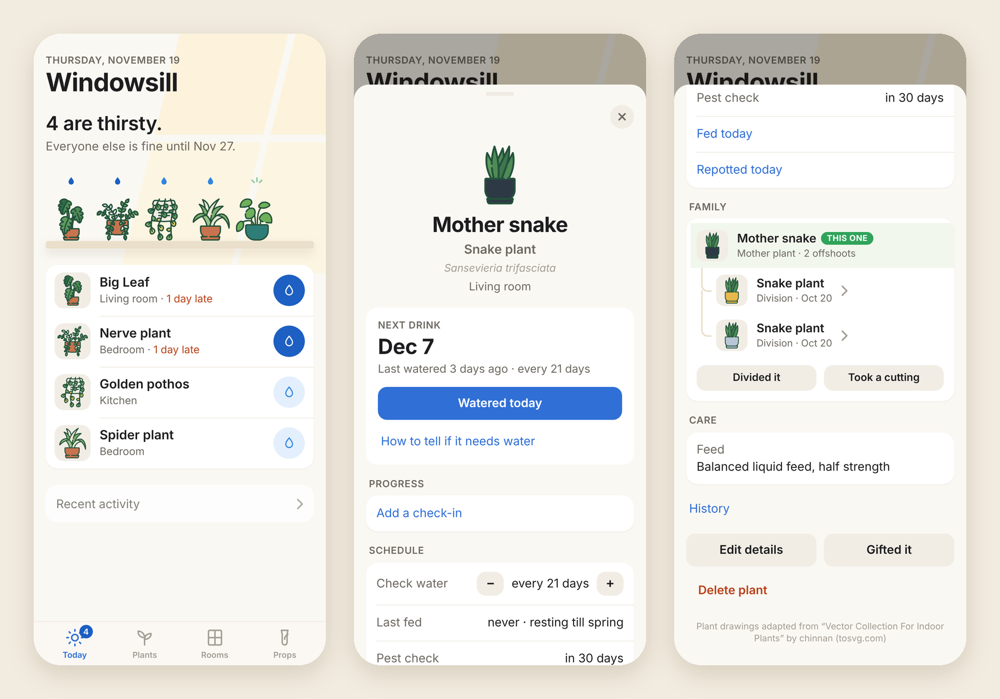
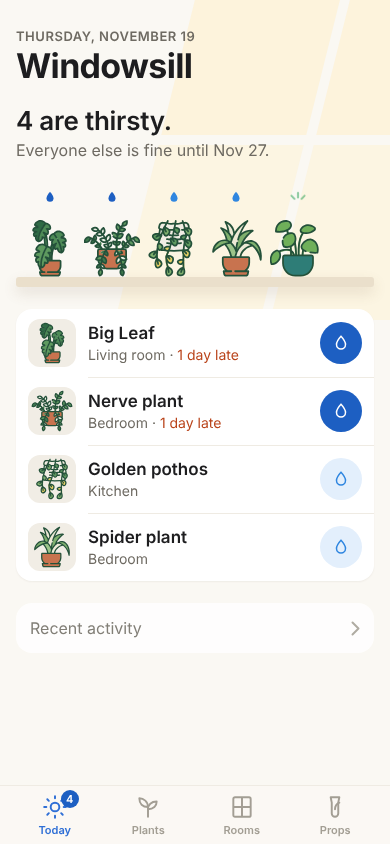
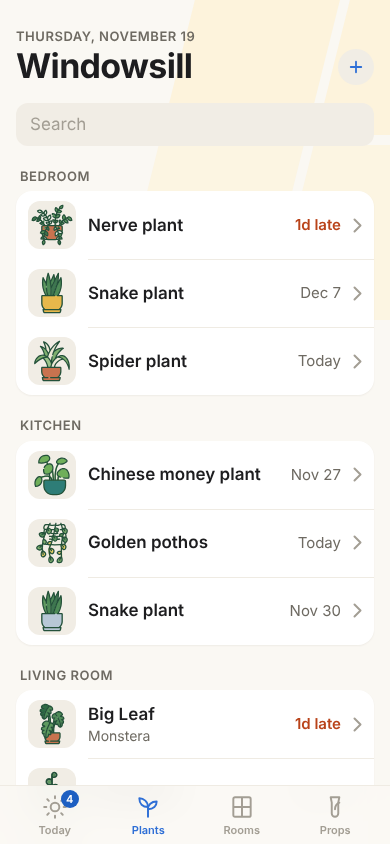
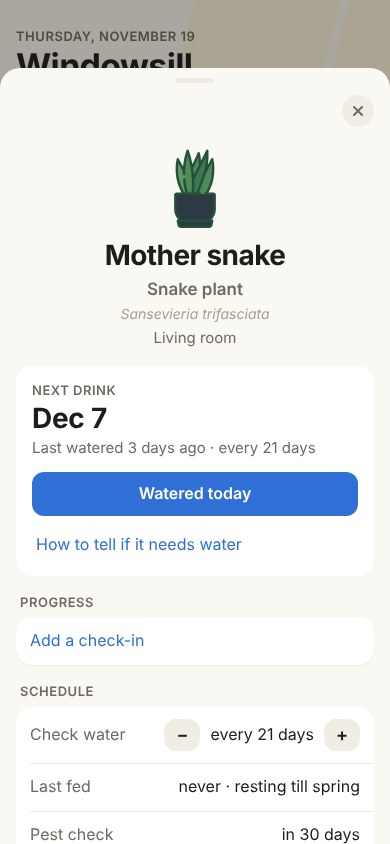
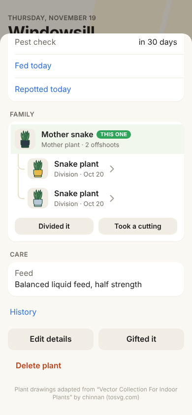

<div align="center">

# 🪴 Windowsill

**A calm, phone-first house plant tracker.** Open it, see who's thirsty, tap the drop. Done.

[](LICENSE)
[](#install-it-on-your-phone)
[](https://supabase.com)
[](#how-it-works)
[](#privacy)



<sub>Screenshots use made-up demo plants.</sub>

</div>

---

## Why

Most plant apps want a subscription before they'll remind you to water a cactus.
Windowsill is a free, open alternative you host yourself: your own account, your own data,
no ads, no paywall. It's built to feel like morning light on a sill: warm, quiet, and only
as many words as you need at a glance, with the detail one tap away.

## Features

**Daily care**
- 💧 **Today view.** Everything due for water, latest first, with a one-tap *Watered* button and an *Undo* on every action.
- 📅 **Per-plant schedules** for watering, feeding (with a winter rest), pest checks and repotting.
- 🏠 **Rooms and light.** Rooms carry their window direction and light level; weekday-only rooms (an office, say) slide weekend chores to Monday.
- 🐈 **Pet safety.** A small cat icon flags plants that are toxic to cats and whether a cat can reach them.

**Each plant's story**
- 📸 **Photo check-ins** with a health rating and tags, shown as a progress timeline and as list thumbnails.
- 🌳 **Family tree.** Record divisions, pups and cuttings, and see every plant's mother and offshoots.
- ✂️ **Props list** for cuttings that are rooting, potted up, gifted or for sale; pot one up and it becomes a linked plant.
- 🎁 **Gifting.** Give a plant away and it leaves your schedule but keeps its history.

**The app itself**
- 📱 **Installable PWA.** Add to Home Screen on iPhone or Android; the app shell works offline.
- 🔐 **Sign in with an emailed code** (no passwords), and every user's data is private to them.
- 🔔 **Push reminders** (opt-in, see [Roadmap](#roadmap)).
- 🎨 **Plant illustrations** matched to each plant's kind (snake plant, monstera, pothos, pilea and more), so the list reads at a glance even before you add photos.

<table>
  <tr>
    <td align="center"><br><sub>Today</sub></td>
    <td align="center"><br><sub>Plants by room</sub></td>
    <td align="center"><br><sub>A plant's sheet</sub></td>
    <td align="center"><br><sub>Family tree</sub></td>
  </tr>
</table>

## Quick start

You need a free [Supabase](https://supabase.com) project and any static host
(Cloudflare Pages, Netlify, Vercel, GitHub Pages…). About 15 minutes, all on free tiers.

```bash
git clone https://github.com/mfscifly/windowsill.git
cd windowsill

# 1. In Supabase: SQL Editor → paste and run supabase/schema.sql
# 2. Build with your project's URL and publishable key (never the secret key)
SUPABASE_URL=https://xxxx.supabase.co SUPABASE_KEY=sb_publishable_... bash scripts/build.sh

# 3. Try it locally
python3 -m http.server -d dist 8080   # then open http://localhost:8080
```

To deploy on **GitHub Pages**, set Settings → Pages → Source to "GitHub Actions" and add the
repository variables `SUPABASE_URL` and `SUPABASE_KEY`; the included workflow publishes the
app at `/app/`. On any other host, use build command `bash scripts/build.sh`, output directory
`dist`, and the same two environment variables.
The full walkthrough, including the sign-in email template, is in **[docs/setup.md](docs/setup.md)**.

> [!IMPORTANT]
> Only the **anon public** key belongs in the app. Never put Supabase's `service_role` key in
> the build, the browser, or git.

### Install it on your phone

Open your deployed address in Safari (iPhone) or Chrome (Android), sign in with the emailed code,
then **Share → Add to Home Screen**. On iPhone, notifications only work from the home-screen app.

## How it works

```
 ┌──────────────── your phone ────────────────┐         ┌──────── Supabase ────────┐
 │  src/app.html      the whole UI, one page  │         │  Auth   email code login │
 │        │  collection().doc().update()      │  HTTPS  │  Postgres  docs table    │
 │  js/backend.js     tiny data adapter  ─────┼────────►│    row-level security    │
 │  sw.js             offline shell + push    │         │  Storage   private photos│
 └────────────────────────────────────────────┘         └──────────────────────────┘
```

Think of `js/backend.js` as a travel plug adapter: the app is written against a small
document-store API (`collection`, `doc`, `onSnapshot`, `update`), and the adapter plugs that
into Supabase. Swap the adapter and the same page could sit on another backend.

- **No framework, no bundler.** Plain HTML, CSS and JavaScript; `scripts/build.sh` just wraps the
  page and writes a config file.
- **One table.** Each record is a JSON document in a `docs` table keyed by user, collection and id.
  Postgres row-level security means a user can only ever read or write their own rows.
- **Photos** go to a private Storage bucket, shrunk to 1600px JPEG first, and load through
  expiring signed URLs.
- **Realtime.** Changes made on one device show up on your others without a refresh.

| Path | What it is |
| --- | --- |
| [`src/app.html`](src/app.html) | The whole app UI: one self-contained page. |
| [`js/backend.js`](js/backend.js) | Email-code sign-in, documents, photos and push opt-in on Supabase. |
| [`supabase/schema.sql`](supabase/schema.sql) | Tables, privacy rules and the photo bucket. Run once per project. |
| [`manifest.webmanifest`](manifest.webmanifest), [`sw.js`](sw.js), [`icons/`](icons) | Home-screen install, offline shell, notifications. |
| [`scripts/build.sh`](scripts/build.sh) | Builds `dist/` and writes `js/config.js` from env vars. |
| [`scripts/screenshots.js`](scripts/screenshots.js) | Regenerates the README screenshots from demo data (Playwright). |
| [`docs/`](docs) | [Setup guide](docs/setup.md) and [data schema](docs/schema.md). |

## Privacy

- This repository contains **code only**: no plant records, photos or keys.
- Your data lives in **your** Supabase project. Nobody else, including the author, can see it.
- No analytics, no ads, no third-party trackers. The only outside requests are to your Supabase
  project, the Supabase JS library on jsDelivr, and Google Fonts.
- Local exports and backups (`data/`, `*.local.*`, `backup*.json`) and `.env` files are gitignored.

## Roadmap

- [x] Watering, feeding, pest-check and repot schedules
- [x] Rooms with light levels and pet-reach flags
- [x] Photo check-ins and progress timeline
- [x] Family tree for divisions and cuttings
- [x] Installable PWA with email-code accounts
- [ ] Daily push reminder sender (subscriptions are stored; the scheduled job that sends them isn't built yet)
- [ ] Export and import your plants as JSON
- [ ] Import from other plant apps
- [ ] Hosted demo with sample plants

Ideas and bug reports are welcome in [Issues](https://github.com/mfscifly/windowsill/issues).

## Contributing

Small, focused pull requests are very welcome. See **[CONTRIBUTING.md](CONTRIBUTING.md)** for how
to run it locally and the few house rules (the main one: never commit real plant data, photos or keys).
To report a security problem privately, see [SECURITY.md](SECURITY.md).

## Credits and license

Code is released under the **[MIT License](LICENSE)**.

Most plant drawings are adapted from *"Vector Collection For Indoor Plants"* by **chinnan**, via
[tosvg.com](https://tosvg.com/collections/vector-collection-for-indoor-plants), under a Creative
Commons license that requires credit. They are not covered by the MIT license; keep the credit if you
reuse them. Details in [CREDITS.md](CREDITS.md).
